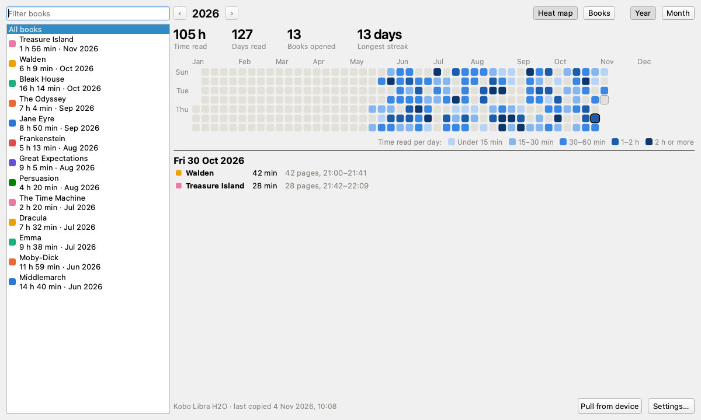
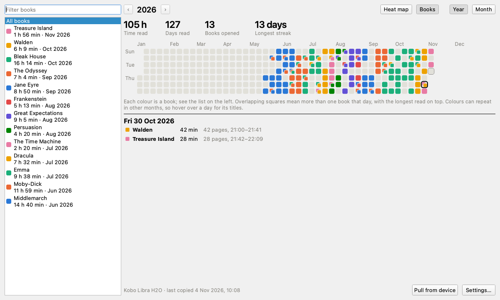
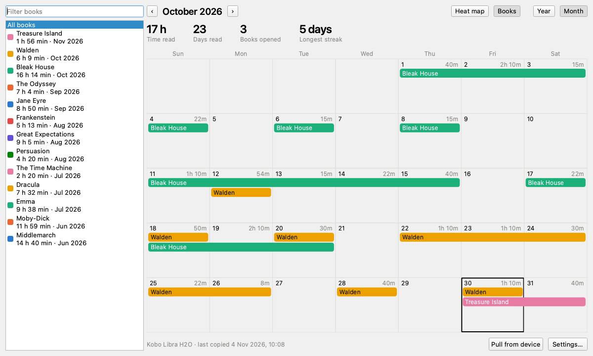
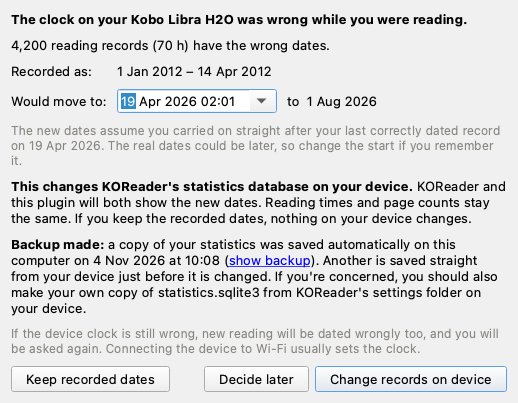

# KOReader Reading Stats for calibre

See when you read each book. This [calibre](https://calibre-ebook.com/) plugin copies [KOReader](https://koreader.rocks/)'s reading statistics when your device connects, and shows them as a calendar.



## Features

- **Year view:** a heat map of reading time, or a colour for each book that overlaps on days you read several.
- **Month view:** a calendar with a bar for each book and the time read each day.
- **Details:** filter by book, or click a day to see what you read, for how long, and how many pages.
- **Syncing:** copy automatically when a device connects, ask each time, or only on request.
- **Clock repair:** finds records written while your device's clock was wrong, and offers to correct them.
- **Several devices:** the same book on different devices is shown as one.

| Books view | Month view |
|---|---|
|  |  |

## Install

**From calibre** (once listed in the plugin index): go to **Preferences → Plugins → Get new plugins** and search for KOReader Reading Stats.

**By hand:** download the zip from [Releases](https://github.com/luke-shields/koreader-reading-stats/releases), then go to **Preferences → Plugins → Load plugin from file**.

Restart calibre, then connect your device. **KOReader Stats** appears in the toolbar and menu bar. It needs calibre 6 or later.

## Device support

Automatic copying needs a device that mounts as a drive.

| Device | KOReader's location | Status |
|---|---|---|
| Kobo | `.adds/koreader` | Tested on a Libra H2O with macOS |
| Kindle, Cervantes, reMarkable | `koreader` | Should work, not yet tried on a real device |
| PocketBook | `applications/koreader` or `system/koreader` | Should work, not yet tried on a real device |
| Android (MTP), wireless | | Not automatic. Copy `statistics.sqlite3` to your computer and use **Import a statistics file** |

Used it on something else? Please [send a device report](https://github.com/luke-shields/koreader-reading-stats/issues/new?template=device_report.yml), whether or not it worked.

## Wrong device clock

E-readers can lose track of the date when the battery runs flat, often restarting in 2012. Everything you read after that gets the wrong date, so it lands in the wrong place on a calendar.



When the plugin finds this, it shows how many records are affected and where they would move to. You can then:

- **Change records on device:** corrects KOReader's own database, so KOReader and the plugin both show the new dates.
- **Keep recorded dates:** changes nothing.
- **Decide later:** asks again next time.

### How the database is protected

This is the only time the plugin writes to a device, and only after you click the button. It changes a separate copy, checks it, saves a backup to your computer, writes the copy to the device, reads it back to confirm it matches, and then swaps it in as a single step. If it's interrupted before the swap, the original stays in place.

To undo a change, eject the device from calibre but leave it connected as a drive, then copy the backup over `statistics.sqlite3` in KOReader's `settings` folder and rename it to match. Anything read since is lost from your statistics. **Open data folder** in the plugin's menu takes you to the `backups` folder.

Device writes are new, and have only run for real on one Kobo. If your reading history matters to you, make your own copy of `statistics.sqlite3` first.

### Known limitation

Clock problems are detected from records being far out of order. KOReader's option to sync statistics between devices could add older records out of order, which might look like a clock problem. Nothing changes unless you confirm it, so choose **Keep recorded dates** if the pop-up looks wrong. Please report it if this happens to you.

## Privacy

The plugin makes no network connections. Your statistics stay on your device and in calibre's settings folder, under `plugins/koreader_stats_data`.

## Development

```bash
python3 tests/test_stats.py
```

```bash
QT_QPA_PLATFORM=offscreen calibre-debug tests/test_window.py
```

```bash
python3 tools/build.py && python3 tools/check_release.py
```

```bash
calibre-customize -a "dist/KOReader Reading Stats.zip"
```

See [CONTRIBUTING.md](CONTRIBUTING.md) for more, including how releases work.

## Licence

[GNU General Public License v3.0](LICENSE).
